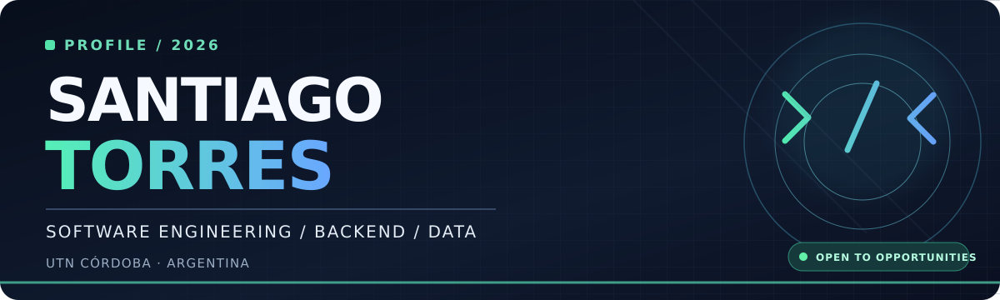
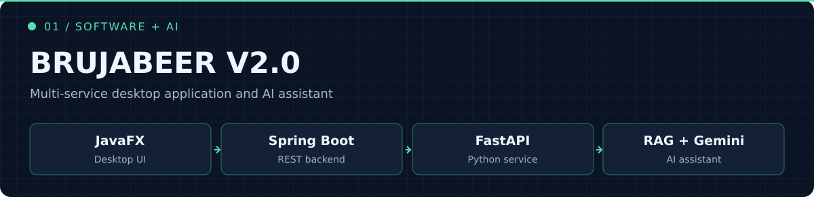
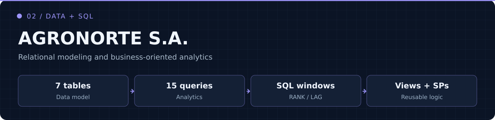
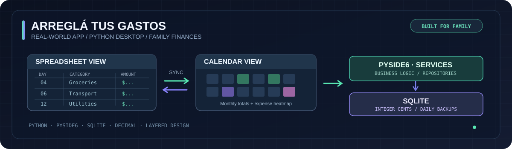

<!--
  SANTIAGO TORRES / GitHub Profile README
  Custom artwork in /assets. Built to render on GitHub without JavaScript.
  Links verified against publicly visible repositories on October 29, 2026.
-->

<div align="center">
  

  <br />

  <a href="https://readme-typing-svg.demolab.com/demo/">
    
  </a>

  <br />
  <a href="https://www.linkedin.com/in/santiago-agustin-torres/"></a>
  <a href="https://github.com/santiagustintorres06-dotcom?tab=repositories"></a>
  <a href="https://github.com/santiagustintorres06-dotcom"></a>
</div>

<br />

## `> whoami`

```text
santiago@utn:~$ cat about.txt

  Name       : Santiago Agustín Torres
  Location   : Córdoba, Argentina
  Education  : Information Systems Engineering · UTN FRC
  Focus      : Backend development · Data · Software architecture
  Building   : Java and Python applications, REST APIs, SQL analytics
  Exploring  : Cloud engineering and production-ready systems
  Mindset    : Understand the system. Design the solution. Ship the code.
```

I’m an **Information Systems Engineering student at UTN Córdoba** who enjoys connecting the dots between **software architecture, backend development, databases, and AI**.

I enjoy turning real problems into usable software: a family expense organizer, a brewing production system with AI-assisted features, and SQL analytics for a realistic business scenario. I'm interested in **internship and trainee opportunities** where I can keep growing as an engineer.

---

## `> selected_projects` 

### 01 · BrujaBeer V2.0 — Software Engineering + AI

<a href="https://github.com/santiagustintorres06-dotcom/brujabeer-recetario"></a>

A multi-component application combining a **Java desktop interface**, **Spring Boot backend**, and a **Python/FastAPI AI service**. The assistant uses **retrieval-augmented generation (RAG)** with **ChromaDB and Gemini**.

**Engineering highlights:** cross-service integration · REST API design · layered architecture · AI-powered retrieval

<a href="https://github.com/santiagustintorres06-dotcom/brujabeer-recetario"></a>


### 02 · AgroNorte S.A. — SQL & Data Analytics

<a href="https://github.com/santiagustintorres06-dotcom/agronorte-sales-analysis"></a>

An end-to-end relational database and sales analytics project built around a realistic business scenario. It includes a **7-table schema**, **15 analytical SQL queries**, **window functions**, **views**, and **stored procedures**.

**Engineering highlights:** relational modeling · joins and CTEs · RANK / LAG / PARTITION BY · reusable SQL logic

<a href="https://github.com/santiagustintorres06-dotcom/agronorte-sales-analysis"></a>

### 03 · Arreglá tus Gastos — A Real-World Python Application

<a href="https://github.com/santiagustintorres06-dotcom/arreglatusgastos"></a>

I built this **Python desktop application to solve a real need in my family**: keeping monthly expenses organized and easy to review. Unlike a classroom-only assignment, it was designed around people who would actually use it.

- **Two synchronized views:** spreadsheet-style editing and a monthly calendar with daily totals and expense intensity.
- **Reliable financial calculations:** stores monetary values in integer cents and uses `Decimal` to avoid floating-point rounding issues.
- **Maintainable design:** separates the PySide6 interface, business services, data repositories, and SQLite database.
- **Portable by design:** local data storage, automated daily backups, and test coverage.

**Engineering highlights:** Python · PySide6 · SQLite · layered architecture · data consistency

<a href="https://github.com/santiagustintorres06-dotcom/arreglatusgastos"></a>

---

## `> academic_projects_and_experiments`

These smaller projects document **what I learned by building**, from classic computer science algorithms to integrating third-party APIs.

| Project | Context | What I practiced |
| :--- | :--- | :--- |
| **[Mail Logistics System](https://github.com/santiagustintorres06-dotcom/mail-logistics-system)** | **University coursework** — final project for Algorithms & Data Structures at UTN | Python, object-oriented programming, Shell Sort, CSV and binary-file processing, statistical matrices. |
| **[Sentimentfy](https://github.com/santiagustintorres06-dotcom/sentimentfy)** | **API integration experiment** — a Discord music recommendation bot | Python, `discord.py`, external AI and Spotify APIs, service separation, API authentication and responses. |

<sub>I keep these separate from my featured applications to distinguish **academic exercises and learning experiments** from larger, use-case-driven work.</sub>

---

## `> tech_stack`

**Languages**


**Backend & AI**


**Databases & tools**


<sub>Currently expanding my knowledge of **Docker and cloud technologies**.</sub>

---

## `> engineering_mindset`

<table>
<tr>
<td width="33%" align="center"><b>01 / BUILD</b><br /><br />APIs, modular services,<br />backend architecture</td>
<td width="33%" align="center"><b>02 / ANALYZE</b><br /><br />SQL, relational design,<br />data-driven insights</td>
<td width="33%" align="center"><b>03 / LEARN</b><br /><br />Cloud fundamentals,<br />system design, new tools</td>
</tr>
</table>

<div align="center">

### Let's build something meaningful.

Open to **internships**, **trainee positions**, and opportunities to learn with strong engineering teams.

<a href="https://www.linkedin.com/in/santiago-agustin-torres/"></a>

<sub>Designed with intention · Córdoba, Argentina</sub>

</div>
